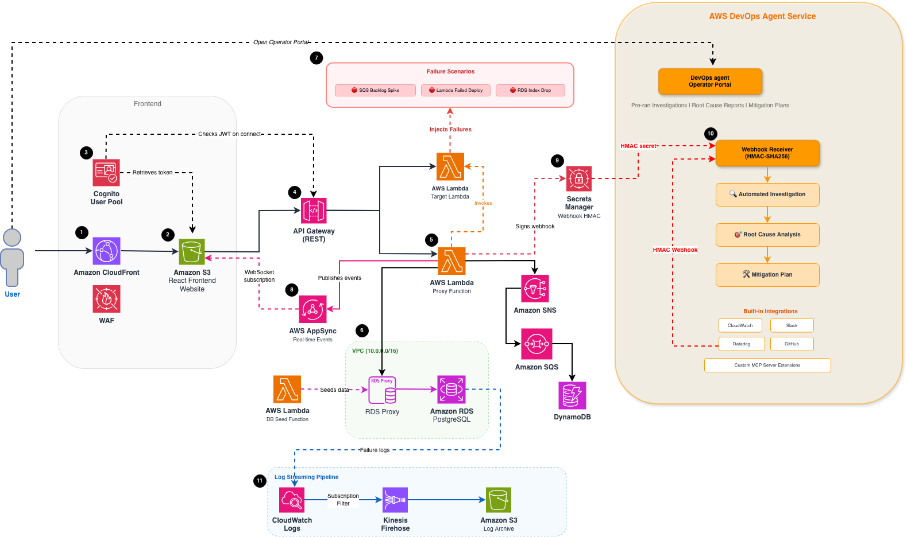

# AnyCompany CRM - AWS DevOps Agent Service Demo

> **A demo application for showcasing AWS Agent services**

## Overview

This is a demo application designed to highlight the functionality of AWS Agent services. It uses a fictitious CRM scenario (AnyCompany CRM) as a vehicle to demonstrate various AWS capabilities. This is not a real CRM system.

### Purpose

This application serves as a demonstration environment for:
- AWS Agent services and capabilities
- Serverless architecture patterns
- AWS service integrations
- Modern web application development on AWS

## 🚀 Deploying in Your Own Isengard Account?

If you're deploying this demo in your own Isengard account, use the **`all-native-version`** branch from GitLab. This branch removes third-party dependencies (Datadog, GitHub, Slack) and relies entirely on native AWS services, making it simpler to deploy without external integrations.

👉 **[all-native-version branch on GitLab](https://gitlab.aws.dev/genai-labs/demo-assets/devops-agent-demo/-/tree/all-native-version?ref_type=heads)**

## Quick Links

- � **[Detailed Documentation](./README.demo.md)** - Complete CRM documentation
- 🎯 **[Setup Guide](./lib/stacks/frontend/app/DEMO-PREPARATION.md)** - Deployment checklist and guide
- 🖼️ **[CRM Assets](./tools/README-crm-assets.md)** - Mock data and images are included and seeded on deployment

## GitHub Integration Branch

The `crm-app-only-gh` branch contains the version of this codebase that is pushed to GitHub and integrated with the AWS DevOps Agent. This branch has all failure simulator code stripped out — the admin handler, simulator UI components, and related infrastructure are removed so that only the core CRM application code remains.

This separation is intentional: when the DevOps Agent investigates an incident, it has access to the GitHub repository for code context. If the failure simulator code were present in the repo, the agent could discover it during investigation and identify the issue as an intentional simulation rather than a genuine production problem. By keeping the simulator code out of the GitHub-connected branch, the agent performs a clean, realistic investigation — analyzing logs, metrics, IAM policies, and deployment history without any hints that the failure was orchestrated.

## Features

### Pipeline Dashboard
- Track sample opportunities across sales stages
- Basic metrics and filtering
- Search and sort functionality

### Account Management
- View sample customer accounts
- Industry categorization
- Basic account details

### Personal Pipeline
- Individual sales rep views
- Sample quota tracking
- Performance metrics

### Team Performance
- Team-wide analytics
- Individual rep performance
- Basic reporting


## Getting Started

### Prerequisites

- Node.js 18+
- Python 3.9+
- Docker
- AWS CDK CLI
- AWS Account with appropriate permissions

### Quick Start

```bash
# 1. Clone and install
git clone [repository-url]
cd [repository-name]
npm install

# 2. Update cdk.json context values
# Open cdk.json and fill in the placeholder values under "context":
#
#   "devOpsAgentWebhookUrl": "{DEVOPS_AGENT_WEBHOOK}"  # your DevOps Agent webhook URL
#   "githubRepo": "genai-labs-demo/devops-agent-demo-gh"  # your GitHub repo (owner/name)
#   "githubPat": "{PAT_HERE}"                          # your GitHub personal access token
#
# Then add/update your AWS account under context.accounts:
#
#   "accounts": {
#       "dev": {
#           "number": "{ACCOUNT_NUMBER}",             # your 12-digit AWS account number
#           "region": "us-east-1",
#           "midway": false
#       }
#   }
#
# The alias (e.g. "dev") is what you select when running the kit CLI.
# Set "midway" to true if using Federate/Midway authentication.

# 3. Deploy to AWS using kit CLI
npm run kit
# Select your account, then choose "Deploy CDK Stack(s)"

# Or deploy all stacks directly
npm run kit -- deploy dev --all

# 4. Store the DevOps Agent webhook secret in AWS Secrets Manager
# After the first deploy, a Secrets Manager secret named "{stage}-devops-agent-webhookSecret"
# is created automatically. You need to set its value to your webhook HMAC secret:
aws secretsmanager put-secret-value \
  --secret-id dev-devops-agent-webhookSecret \
  --secret-string "YOUR_WEBHOOK_SECRET_HERE"

# 5. Access the application
# Open CloudFormation console → Find frontend stack → Click CloudFront URL
```

### Local Development

```bash
# Start frontend dev server
npm run -w frontend dev

# Build frontend
npm run -w frontend build

# Run tests
npm run -w frontend test
```

Visit http://localhost:5173 to see the demo application locally.


## Integrating with AWS DevOps Agent

After deploying the CRM infrastructure and creating your AWS DevOps Agent agentspace, configure the following third-party integrations so the agent can detect, investigate, and communicate about incidents.

> **Note:** AWS DevOps Agent supports a wide range of third-party integrations including observability platforms (Datadog, Dynatrace, New Relic, Splunk), communication tools (Slack, ServiceNow, PagerDuty), code repositories (GitHub, GitLab), and custom integrations via MCP. For this demo, we use **Datadog** for observability, **GitHub** for code context, and **Slack (Amazon Sandbox)** for team notifications.

### AWS IAM Identity Center (IdC) Setup

If you're deploying in your own account, you'll need to create a user in AWS IAM Identity Center (IdC) to access the AWS DevOps Agent portal from the CRM web app. The DevOps Agent console uses IdC for authentication, so without an IdC user you won't be able to view investigations.

**Steps:**
1. In the AWS Console, navigate to **IAM Identity Center** → **Users** → **Add user**
2. Create a user with your email address and set a password
3. Assign the user to the appropriate permission set that includes access to the DevOps Agent service
4. Use these IdC credentials when accessing the DevOps Agent portal from the CRM app's Step 2 integration link. Be sure to update the username and password in the code.

### AWS Account Setup — Sub-Account Recommendation

Third-party integrations (Datadog, GitHub, etc.) require IAM roles that grant external access to your AWS account. If these roles are created directly in an Isengard-managed account, a Sev-2 security ticket will be automatically generated due to the external trust policy.

**To avoid this**, create a sub-account under your AWS Organization (within an OU) and deploy the demo infrastructure there. Sub-accounts under an Organization do not trigger Sev-2 tickets for external IAM role trust policies.

**Steps:**
1. In your Isengard account, go to **AWS Organizations** → **Create Account** (or use an existing sub-account within an OU)
2. Deploy the CRM CDK stacks into the sub-account
3. Configure the 3P integrations (Datadog, GitHub, etc.) in the sub-account — IAM roles with external trust policies will not trigger security tickets

For additional guidance on managing external access roles and avoiding security ticket escalations, see the [Aristotle implementation guide](https://aristotle.corp.amazon.com/implementations/418).

### 1. Datadog Integration

Connect Datadog to your AWS environment so the DevOps Agent can pull metrics, traces, and alerts during investigations.

1. In the AWS DevOps Agent console, navigate to your agentspace → **Integrations** → **Add Integration** → **Datadog**
2. Provide your Datadog API Key and Application Key (found in Datadog under **Organization Settings → API Keys**)
3. Configure the Datadog site region (e.g., `datadoghq.com`, `us5.datadoghq.com`)
4. Select the AWS account and services to monitor

<!--  -->

> **Tip:** Ensure your Datadog agent is installed on the relevant infrastructure (Lambda, ECS, EC2) and forwarding metrics before connecting.

### 2. GitHub Integration

Link your GitHub repositories so the DevOps Agent can correlate deployments, review recent commits, and identify code changes that may have caused failures.

1. In the agentspace, go to **Integrations** → **Add Integration** → **GitHub**
2. Authorize the AWS DevOps Agent GitHub App for your organization
3. Select the repositories relevant to your application (e.g., this CRM repo)
4. The agent will now have access to commit history, pull requests, and deployment events

<!--  -->

### 3. Slack Integration (Amazon Sandbox)

Set up Slack so the DevOps Agent can post investigation updates, alerts, and mitigation plans to your team channel.

1. In the agentspace, go to **Integrations** → **Add Integration** → **Slack**
2. Authorize the connection to your Slack workspace (for this demo, the **Amazon Sandbox** workspace)
3. Select the target channel (e.g., `#devops-agent`) where the agent will post updates
4. Configure notification preferences — which severity levels trigger Slack messages

<!--  -->

> **Note:** For the Amazon Sandbox workspace, you may need a workspace admin to approve the app installation. Contact your admin if prompted.

### 4. Creating Webhooks for AWS DevOps Agent

Webhooks allow your monitoring tools to trigger investigations in the AWS DevOps Agent service when alerts fire.

#### Setting up the webhook endpoint

1. After deploying the CDK stack, a webhook endpoint is created automatically via API Gateway
2. A Secrets Manager secret named `{stage}-devops-agent-webhookSecret` stores the HMAC signing secret
3. Set the webhook secret value:

```bash
aws secretsmanager put-secret-value \
  --secret-id dev-devops-agent-webhookSecret \
  --secret-string "YOUR_WEBHOOK_SECRET_HERE"
```

#### Configuring webhook triggers

1. In the AWS DevOps Agent console, navigate to your agentspace → **Webhooks**
2. Copy the webhook URL provided for your agentspace
3. In your monitoring tool (e.g., Datadog, CloudWatch), create a webhook notification that points to this URL
4. Include the HMAC signature header so the agent can verify the request authenticity

<!--  -->

#### Example: Datadog webhook

1. In Datadog, go to **Integrations → Webhooks → New Webhook**
2. Set the URL to your agentspace webhook endpoint
3. Add the HMAC signature header as configured in Secrets Manager
4. Attach the webhook to your Datadog monitors (e.g., high error rate, latency spike)

<!--  -->

When an alert fires, the webhook triggers the DevOps Agent to automatically begin an investigation — mapping resources, analyzing logs, identifying root cause, and generating a mitigation plan.


## Architecture



### Architecture Workflow

AWS DevOps Agent integrates with your observability tools, CI/CD pipelines, and communication channels to provide autonomous incident response.

1. User accesses app via CloudFront, protected by AWS WAF
2. CloudFront serves the React frontend from S3 origin
3. Cognito authenticates the user and issues a JWT token
4. API Gateway validates the JWT and routes REST requests
5. Proxy Lambda handles API logic and invokes backend services
6. RDS Proxy manages connections to PostgreSQL inside the VPC
7. Admin triggers failure scenarios (SQS backlog, Lambda deploy, RDS index)
8. AppSync streams real-time failure events to the frontend via WebSocket
9. Lambda signs an HMAC webhook using Secrets Manager
10. DevOps Agent receives the webhook, investigates, performs RCA, and generates a mitigation plan
11. Failure logs stream through CloudWatch → Firehose → S3 for analysis

### Technology Stack

**Frontend:**
- React 18 + TypeScript
- Vite build tool
- AWS Cloudscape Design System
- React Router v6
- AWS Amplify for backend integration

**Backend:**
- Amazon S3 + CloudFront for hosting
- Amazon Cognito for authentication
- API Gateway + Lambda for REST API
- Amazon RDS PostgreSQL with RDS Proxy
- Amazon VPC with private subnets
- AWS WAF for security

### Project Structure

```
├── lib/stacks/
│   ├── frontend/              # Frontend hosting and React app
│   │   └── app/              # CRM application
│   │       ├── src/pages/CRM/    # CRM pages and components
│   │       └── README-CRM.md
│   └── backend/              # Backend services
│       ├── constructs/
│       │   └── auth.ts       # Cognito authentication
│       ├── rest-api/         # API Gateway REST API
│       ├── database.ts       # RDS PostgreSQL database
│       ├── networking.ts     # VPC configuration
│       └── storage/          # S3 storage
├── tools/                    # Image generation scripts
│   ├── generate-crm-assets.sh
│   └── README-crm-assets.md
└── docs/                     # Documentation
    └── kit/                  # Starter kit docs
```

## Fictitious Data

The application includes generated fictitious data for demo purposes:

- **50,000 Mock Opportunities**: Randomly generated for demonstration
- **75 Fictitious Accounts**: Sample company data
- **12 Demo Users**: Simulated sales reps and managers

**Note**: All data is completely fictitious and generated for demonstration purposes only.


## Future Enhancements

### Performance Targets
- ✅ Page load: < 2 seconds
- ✅ Filter response: < 500ms
- ✅ Search response: < 300ms (debounced)
- ✅ Table sorting: Instant

### Browser Support
- Chrome 90+
- Firefox 88+
- Safari 14+
- Edge 90+


## Pricing Estimation

| AWS Service | Monthly Cost (Estimated) |
|-------------|-------------------------|
| Amazon S3 | $5 - $20 |
| Amazon CloudFront | $10 - $50 |
| AWS WAF | $10 - $30 |
| Amazon Cognito | $0 - $10 (first 50K MAU free) |
| Amazon API Gateway | $5 - $20 |
| Amazon RDS PostgreSQL | $50 - $150 |
| **Total** | **$120 - $380/month** |

*Use [AWS Pricing Calculator](https://calculator.aws/) for detailed estimates.*

## Documentation

### Main Documentation
- **[Detailed README](./README.demo.md)** - Complete CRM documentation
- **[CRM Application](./lib/stacks/frontend/app/README-CRM.md)** - Frontend app docs
- **[Image Generation](./tools/README-crm-assets.md)** - Asset generation guide

### Starter Kit Documentation
- **[Machine Setup](./docs/kit/machine-setup.md)** - Developer machine setup
- **[Demo Creation](./docs/kit/demo-creation.md)** - Creating new demos
- **[Demo Setup](./docs/kit/demo-setup.md)** - Setting up existing demos
- **[Design Documentation](./docs/kit/design.md)** - Starter kit architecture

## Troubleshooting

### Build Errors
```bash
# Clear and reinstall
rm -rf node_modules package-lock.json
npm install
```

### Deployment Issues
```bash
# Check AWS credentials
aws sts get-caller-identity

# Bootstrap CDK (first time only)
npm run kit -- bootstrap dev

# Deploy with kit CLI
npm run kit -- deploy dev --all
```

### Frontend Issues
```bash
# Clear Vite cache
rm -rf lib/stacks/frontend/app/node_modules/.vite

# Rebuild
npm run -w frontend build
```


## Clean-up

To remove all AWS resources:

```bash
# Delete all stacks using kit CLI
npm run kit
# Select your account, then choose "Destroy CDK Stack(s)"

# Or use CDK directly
npm run cdk destroy "*/**"
```

**Note**: S3 buckets may need to be emptied before deletion.

## Support

For questions about this demo application:
1. Review the documentation in this repository
2. Contact your AWS support team

## Note

This is a demo application for showcasing AWS Agent services. It is not intended for production use or as a real CRM system.
- Replace mock data with real API calls
- Add comprehensive authentication
- Implement data persistence
- Add error handling and logging
- Implement rate limiting
- Add monitoring and alerting

## License

[Apache License Version 2.0](/LICENSE)
